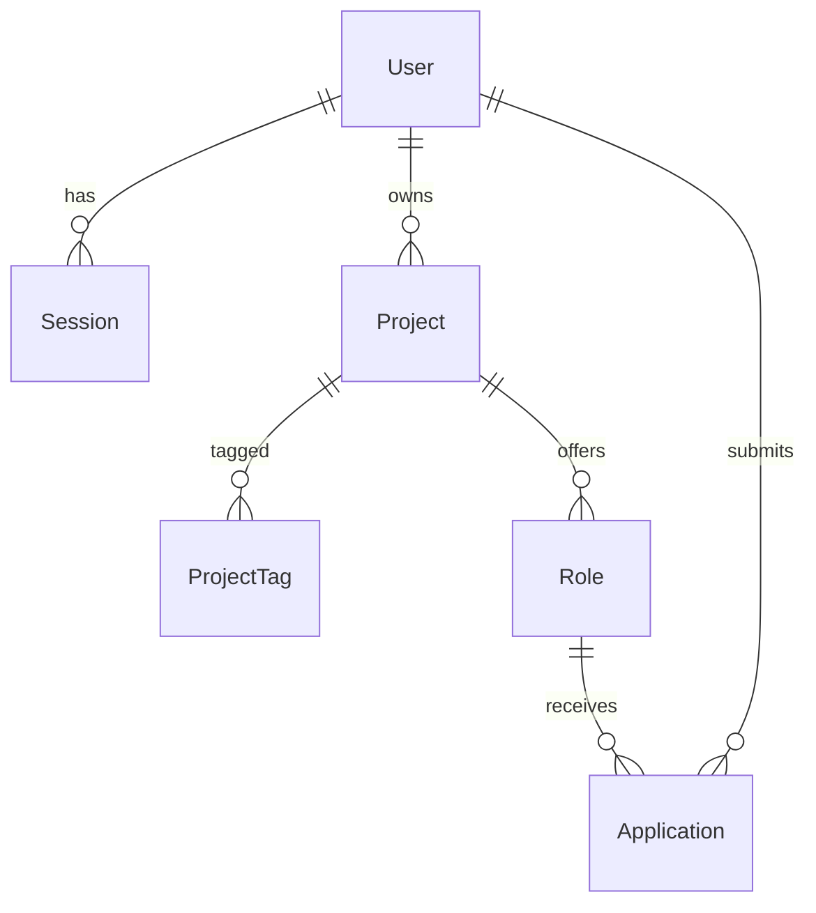

# DevMatch — data model

**Audience:** whoever writes `schema.prisma` and the migrations. The source of entities is `domain-model.md`; here is how they map onto tables.
DBMS: SQLite via Prisma (ADR-0005). Statuses are `String` (Prisma does not support enums on SQLite); the allowed values live in `packages/shared`.

## Tables

### `User`

| Field | Type | Constraints |
|---|---|---|
| `id` | String (cuid) | PK |
| `email` | String | UNIQUE |
| `passwordHash` | String | |
| `displayName` | String | |
| `telegram` | String? | normalized `@name` |
| `createdAt` | DateTime | default now |

### `Session`

| Field | Type | Constraints |
|---|---|---|
| `id` | String | PK (random token, stored in an httpOnly cookie) |
| `userId` | String | FK → User, ON DELETE CASCADE |
| `expiresAt` | DateTime | INDEX |

### `Project`

| Field | Type | Constraints |
|---|---|---|
| `id` | String (cuid) | PK |
| `ownerId` | String | FK → User, INDEX |
| `title` | String | |
| `description` | String | |
| `status` | String | `DRAFT` / `PUBLISHED` / `CLOSED`, default `DRAFT` |
| `publishedAt` | DateTime? | |
| `createdAt` | DateTime | default now |
| `updatedAt` | DateTime | @updatedAt |

Indexes: `(status, publishedAt DESC)` — the catalog query (US-09 AC).

### `ProjectTag`

| Field | Type | Constraints |
|---|---|---|
| `projectId` | String | FK → Project, ON DELETE CASCADE |
| `tag` | String | normalized lower-case, trim |
| `label` | String | as entered by the user (for display) |

PK: `(projectId, tag)`. Index: `(tag)` — the US-10 filter.
Why not a separate `Tag` table: there is no tag dictionary in the MVP (digest, question 7); "popular tags" = `GROUP BY tag ORDER BY COUNT DESC`.

### `Role`

| Field | Type | Constraints |
|---|---|---|
| `id` | String (cuid) | PK |
| `projectId` | String | FK → Project, ON DELETE CASCADE |
| `name` | String | |
| `totalSpots` | Int | 1–5 (checked in the shared schema) |
| `availableSpots` | Int | 0..totalSpots |
| `status` | String | `OPEN` / `FILLED`, default `OPEN` |
| `createdAt` | DateTime | default now |

UNIQUE: `(projectId, name)` — US-03 sc.3. **Note:** SQLite compares case-sensitively; the service normalizes `name` (trim, collapse whitespace) and additionally checks for a case-insensitive duplicate before INSERT.

### `Application`

| Field | Type | Constraints |
|---|---|---|
| `id` | String (cuid) | PK |
| `roleId` | String | FK → Role, ON DELETE CASCADE, INDEX |
| `applicantId` | String | FK → User, INDEX |
| `telegram` | String | |
| `githubUrl` | String | |
| `comment` | String? | |
| `status` | String | `PENDING` / `APPROVED` / `REJECTED`, default `PENDING` |
| `createdAt` | DateTime | default now |
| `decidedAt` | DateTime? | |

Indexes: `(roleId, status)` — the owner's applications list and the duplicate check; `(applicantId, createdAt DESC)` — "My applications" (US-13).

## ER diagram

## Invariants the schema does NOT express (they live in service transactions, ADR-0007)

| Invariant | Why not in the schema | Where in code |
|---|---|---|
| One active (`PENDING`/`APPROVED`) application per `(applicantId, roleId)` — A1 | partial unique index is not available in Prisma on SQLite | `services/applications.createApplication` — SELECT inside the transaction before INSERT |
| `0 ≤ availableSpots`; decrement only when `> 0` — R-A, R8 | Prisma does not generate CHECK constraints | `updateMany({ where: { id, availableSpots: { gt: 0 } } })` and a `count === 1` check |
| `status == FILLED ⇔ availableSpots == 0` | derived field | the same transaction: after the decrement, if 0 → `status = FILLED` |
| `PUBLISHED ⇒ roles ≥ 1` — P1 | cross-table | `services/projects.publish` — COUNT inside the transaction |
| `APPROVED`/`REJECTED` are terminal — A3 | | `updateMany({ where: { id, status: 'PENDING' } })`, `count === 0` → 409 |
| Role name is unique case-insensitively | SQLite collation | normalization + check in `services/projects.addRole` |
| `status` value from the allowed set | no enums on SQLite | zod enum in `packages/shared`, validation on input; nobody writes to the DB bypassing the services |

## Migrations

- `prisma migrate dev` locally; the DB file `apps/api/prisma/dev.db` is in `.gitignore`.
- Seed (`prisma/seed.ts`) — 2 users, 3 projects (DRAFT/PUBLISHED/CLOSED), roles with different counters, applications in all three statuses — so that every Gherkin scenario can be seen by hand.
- Migration to PostgreSQL (if the trigger from `risks.md` fires): change the `provider`, regenerate the migrations, replace the `String` statuses with `enum` — the model does not change.
