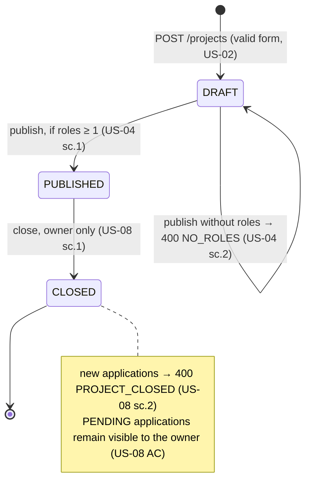
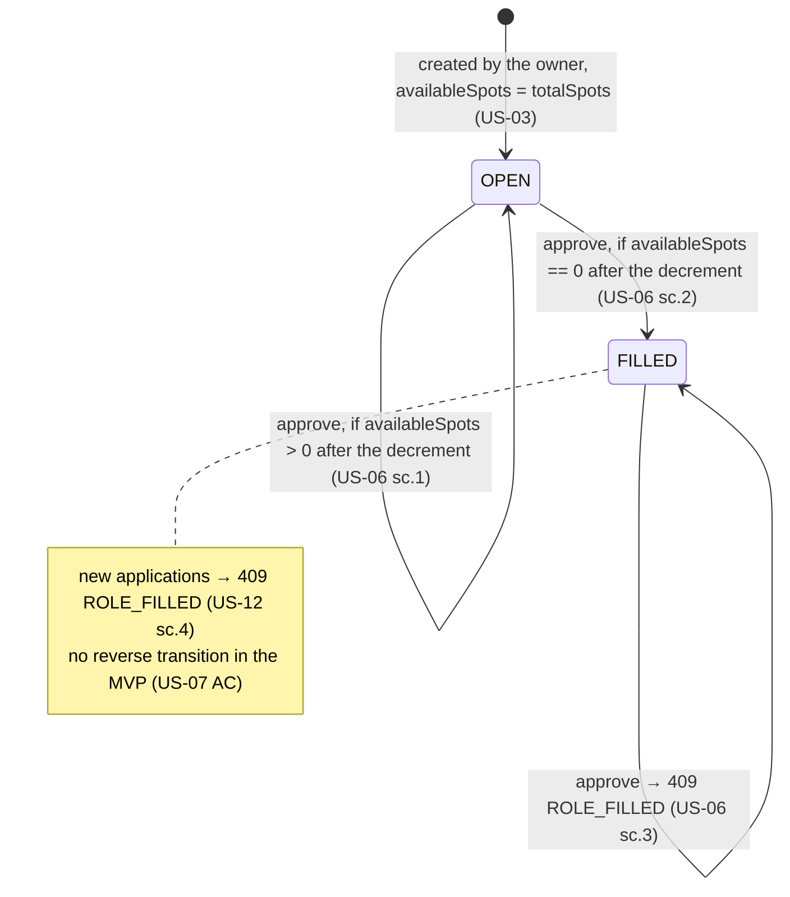
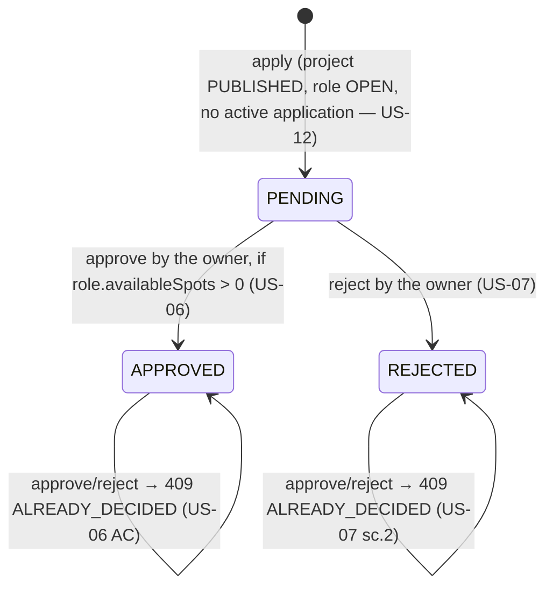

# DevMatch — domain model

**Audience:** everyone who writes code or tests. This is the vocabulary we use to talk about the system, and the rules that must not be broken.
Every rule has a reference to a user story. If a rule has no reference, it should not be here.

## Entities

### User

| Field | Type | Constraints | Source |
|---|---|---|---|
| `id` | id | | |
| `email` | string | unique, email format | ADR-0006 |
| `passwordHash` | string | bcrypt; never serialized | ADR-0006 |
| `displayName` | string | 2–50 characters | digest, question 8 |
| `telegram` | string \| null | `@` + 5–32 characters `[A-Za-z0-9_]`; normalization: trim whitespace, add `@` if missing, store with the case as entered | US-01 AC, sc.1, sc.3 |
| `createdAt` | datetime | | |

Invariants:
- U1. `telegram` is mandatory for **creating a project** (project lead) and is pre-filled in the application form (student). An empty `telegram` does not block browsing the catalog (US-09 AC). — US-01, US-12
- U2. One User can be a project owner and a candidate at the same time (digest A1).

### Project

| Field | Type | Constraints | Source |
|---|---|---|---|
| `id` | id | | |
| `ownerId` | → User | owner, immutable | US-02 AC |
| `title` | string | 5–100 | US-02 AC |
| `description` | string | 30–1000; in the catalog — the first 150 characters | US-02 AC, US-09 AC |
| `tags` | ProjectTag[] | 1–10; `tag` normalized to lower-case, `label` as entered by the user | US-02 AC, US-10 AC |
| `status` | `DRAFT` \| `PUBLISHED` \| `CLOSED` | | US-02, US-04, US-08 |
| `publishedAt` | datetime \| null | set on the transition to PUBLISHED; catalog sorting | US-04 AC, US-09 AC |
| `createdAt` | datetime | shown on the page | US-11 AC |

Invariants:
- P1. `status == PUBLISHED ⇒ publishedAt != null` and `roles.length ≥ 1`. — US-04
- P2. Only `PUBLISHED` projects appear in the public catalog. `DRAFT` is visible only to the owner. — US-09 AC, sc.3; US-02 AC
- P3. `ownerId.telegram` is not included in the project's public DTOs. — US-11 AC, US-14 sc.2

### Role (open role)

| Field | Type | Constraints | Source |
|---|---|---|---|
| `id` | id | | |
| `projectId` | → Project | | US-03 |
| `name` | string | 1–50; unique within the project (case-insensitive, ignoring extra whitespace) | US-03 AC, sc.3 |
| `totalSpots` | int | 1–5 | US-03 AC, sc.2 |
| `availableSpots` | int | `0 ≤ availableSpots ≤ totalSpots`; on creation `= totalSpots` | US-03 AC |
| `status` | `OPEN` \| `FILLED` | `FILLED ⇔ availableSpots == 0` | US-06 AC |

Invariants:
- R-A. `availableSpots` changes **only** in the application-approval transaction (ADR-0007). — US-06, US-07 AC ("the counter is unchanged" on rejection)
- R-B. Only the owner can add roles, and only while the project is in `DRAFT` or `PUBLISHED`. — US-03 AC

### Application

| Field | Type | Constraints | Source |
|---|---|---|---|
| `id` | id | | |
| `roleId` | → Role | an application is for a role, not for a project | US-12 AC |
| `applicantId` | → User | | ADR-0006 |
| `telegram` | string | same as User.telegram; a copy at the moment of submission (pre-filled from the profile) | US-12 AC |
| `githubUrl` | string | valid URL, host `github.com` or `www.github.com` | US-12 AC, sc.2 |
| `comment` | string \| null | ≤ 300 | US-12 AC |
| `status` | `PENDING` \| `APPROVED` \| `REJECTED` | | US-12, US-06, US-07 |
| `createdAt` | datetime | sorting "newest first" | US-05 AC, US-13 AC |
| `decidedAt` | datetime \| null | | |

Invariants:
- A1. For (applicantId, roleId) there is at most **one** application in status `PENDING` or `APPROVED`. `REJECTED` does not block re-applying. — US-12 sc.3
- A2. An application can be created only if the project is `PUBLISHED`, the role is `OPEN`, and `availableSpots > 0`. — US-12 sc.4, US-08 sc.2, US-11 AC
- A3. `APPROVED` and `REJECTED` are terminal. — US-06 AC, US-07 sc.2
- A4. The project owner cannot apply to their own project (open question 1 in the overview). — assumption

## State machines

### Project

### Role

### Application

**One transition — two entities.** `approve` changes `Application.status` and `Role.availableSpots` (and, possibly, `Role.status`). This is a single transaction (ADR-0007). This is exactly the "intersection point" of the two user journeys from `project_context.md`.

## Data visibility (who sees what)

| Data | Public | Authenticated student | Project owner |
|---|---|---|---|
| `PUBLISHED` project: title, description, tags, roles, author's username | ✔ | ✔ | ✔ |
| `DRAFT` project | ✘ | ✘ | ✔ (own) |
| Project owner's Telegram | ✘ | only in their own `APPROVED` application (US-14) | — |
| Project's list of applications (with candidates' GitHub) | ✘ | ✘ | ✔ (US-05) |
| Candidate's Telegram | ✘ | — | only after `APPROVED` (US-06 AC) |
| My applications with statuses | ✘ | own (US-13) | own |

## Glossary

| Term in the requirements | In code | Not to be confused with |
|---|---|---|
| Project lead, initiator, team lead, project author, Project Lead | `owner` (the User that is `Project.ownerId`) | a separate user type — there is none |
| Student, seeker, applicant, candidate | `applicant` (a User in the context of an Application) | |
| Role, open role, vacancy | `Role` | an access role (admin/user) — there are none |
| Application, response to a role | `Application` | |
| Recruitment closed (project) | `Project.status == CLOSED` | `Role.status == FILLED` ("Spots filled") |
