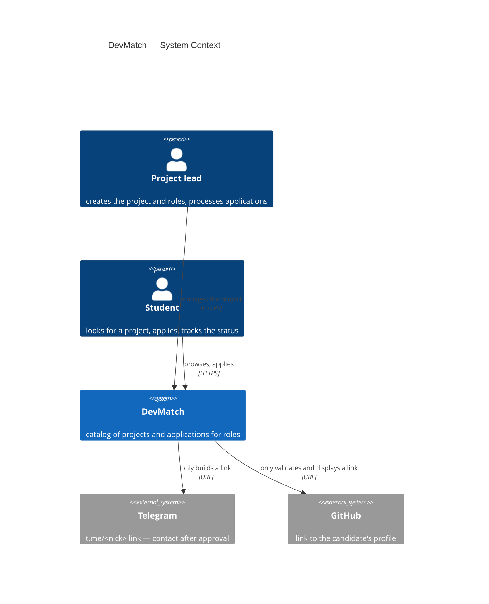
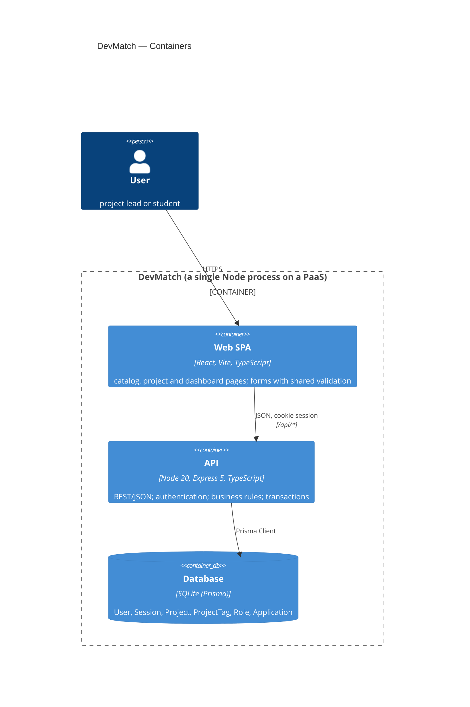
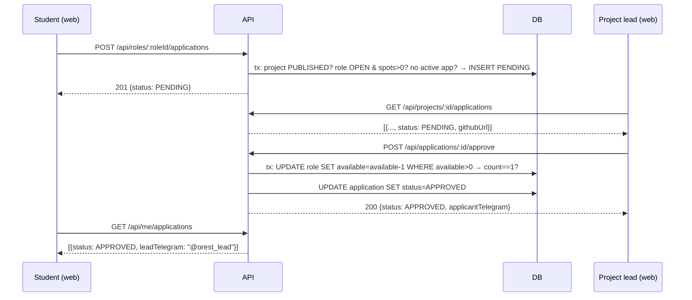

# DevMatch — architecture overview

**Audience:** a new team member. Goal — understand the system in 10 minutes.
**Sources of decisions:** `docs/adr/` (why it is this way), `docs/analysis/requirements-digest.md` (what exactly is required).

## In one paragraph

DevMatch is a web application (React SPA) that talks to a REST API (Node/Express) over a single database (SQLite via Prisma; PostgreSQL is the planned path). There are no external API integrations in the MVP: Telegram and GitHub are present only as links that we validate and display. A single Node process serves both the SPA static files and `/api` (ADR-0008).

## C4 level 1 — System Context

> The arrows to Telegram and GitHub are **not integrations**. The system does not call their APIs, does not check that accounts exist and does not depend on their availability. See `integrations.md`.

## C4 level 2 — Containers

`packages/shared` is not a container but a library: zod validation schemas, status enums and DTO types imported by both web and api (ADR-0002).

## Components

### Web SPA (`apps/web`)

| Component | Responsibility |
|---|---|
| `router` | routes → pages; protection of `/my/*` (redirect to `/login` without a session) |
| `api-client` | `fetch` to `/api`, throws a typed `ApiError` with `code` and `message` from the response |
| `auth` (hook + context) | current user from `GET /api/me`; sign in / sign out |
| `queries` | TanStack Query: cache keys, invalidation after mutations (approved → refresh the applications list and the role counter) |
| `forms` | forms with zod schemas from `shared`; error texts are the English translations of the acceptance-criteria texts |
| `pages` | see the table below |

### API (`apps/api`)

| Component | Responsibility |
|---|---|
| `routes/*` | HTTP: parsing, body validation via `shared`, service call, DTO serialization. No business rules here |
| `middleware/auth` | `requireAuth` (401), loading the user from the session |
| `middleware/validate` | zod schema → 400 `VALIDATION_ERROR` with per-field details |
| `middleware/error` | any error → the single format `{ error: { code, message } }` |
| `services/auth` | registration, sign-in (bcrypt), sessions |
| `services/projects` | creation (DRAFT), roles, publishing (R2), closing; owner check (R6) |
| `services/catalog` | public list and details; filter by tag (R18); hiding DRAFT (R1) and contacts (R5) |
| `services/applications` | applying, approving, rejecting — **the only place** that changes `available_spots`; transactions per ADR-0007 |
| `serializers` | DTO depending on who is asking: `leadTelegram` only for the owner's APPROVED applications (R5, R16) |
| `prisma` | schema, migrations, client |

### Database

Entities and invariants — `domain-model.md`; tables, indexes — `data-model.md`.

## Frontend pages → user stories

| Route | Page | Stories | Access |
|---|---|---|---|
| `/` | Project catalog with a tag filter | US-09, US-10 | public |
| `/projects/:id` | Project card, roles, application form | US-11, US-12 | public view; applying — after sign-in |
| `/login`, `/register` | Sign in / Register | ADR-0006 | public |
| `/onboarding` | Telegram contact | US-01 | after sign-in, if the contact is empty |
| `/my/projects` | My projects | — (navigation) | after sign-in |
| `/my/projects/new` | Create project | US-02 | after sign-in + Telegram filled in |
| `/my/projects/:id` | Manage project: "Roles" and "Applications" tabs | US-03, US-04, US-08 / US-05, US-06, US-07 | owner |
| `/my/applications` | My applications with statuses and the lead's contact | US-13, US-14 | after sign-in |

## End-to-end scenario (the intersection point of the two journeys)

## External systems: integration or link

| System | What we take | Type |
|---|---|---|
| Telegram | username → `https://t.me/<nick>` | **link**; format validation (US-01) |
| GitHub | profile URL | **link**; domain validation (US-12 sc.2) |
| PaaS (Render/Railway) | process hosting + disk for SQLite | infrastructure, not code |

## Open questions (carried over from design)

1. **The owner applies to their own project.** The requirements are silent. Decision in the API: 403 `OWN_PROJECT` (digest, question 3). Needs confirmation from the course owner.
2. **`PENDING` applications for a role that became `FILLED`.** They remain `PENDING` and cannot be approved (R8). The UI shows them with a "No spots left" hint. Auto-rejection — post-MVP.
3. **Creating a project without Telegram.** US-01 makes the contact mandatory for the project lead but does not say exactly when to check it. Decision: `POST /api/projects` → 400 `PROFILE_INCOMPLETE`, the frontend redirects to `/onboarding`.
4. **"Moderator" persona.** Out of MVP scope; the project state machine leaves room for a state between `DRAFT` and `PUBLISHED` (digest A7). No code for now.
